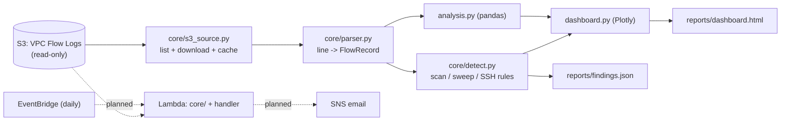

# VPC Flow Log Analyzer with Port-Scan Detection (Python)

A security tool that reads **VPC Flow Logs** from S3 and turns them into answers:

- **Who talks the most?** (top talkers by bytes)
- **Which ports get blocked the most?**
- **When did rejected connections spike?**
- **Is anyone scanning us?** (port scans, port sweeps, SSH brute force)

It is a Python command line tool with a single-file HTML dashboard. The detection code is plain Python (no pandas), so it can later run unchanged inside AWS Lambda for daily email alerts.

## Status (what is built and what is not)

| Part | Status |
|---|---|
| Flow log parser (typed records, gzip, bad-line safe) | Done, tested |
| S3 loader (read-only, by day, local cache) | Done, tested with a fake S3 (moto) and on real logs |
| pandas analysis (top talkers, ports, rejects over time, internal vs external) | Done, tested |
| Detection rules (port scan, sweep, SSH brute force) | Done, 25 tests |
| HTML dashboard (Plotly) | Done, tested |
| Private-only port scanner + validator (`tools/`) | Built and tested; **not yet run against real traffic** |
| Live proof: scan my own server, check detection | **Not run yet** (needs the Project 1 network brought up) |
| Lambda + SNS email + daily schedule (Terraform) | **Not built yet** |

62 automated tests pass. Cost so far: $0 (only S3 reads of a few KB).

## Architecture



Solid lines are built. Dotted lines are the planned cloud alerting part.

`core/` has no pandas on purpose: pandas is very large, and Lambda has package size limits. The command line tool and the future Lambda share the exact same detection code.

## The flow log fields

AWS default format (version 2), 14 fields per line:

```
version account-id interface-id srcaddr dstaddr srcport dstport protocol packets bytes start end action log-status
2 111122223333 eni-0000test 203.0.113.50 10.0.0.10 42983 989 6 1 52 1700000000 1700000030 REJECT OK
```

| Field | Example | Meaning |
|---|---|---|
| version | 2 | log format version |
| account-id | 111122223333 | AWS account that owns the network interface |
| interface-id | eni-0000test | the network card that saw the traffic |
| srcaddr / dstaddr | 203.0.113.50 / 10.0.0.10 | who sent it / who received it |
| srcport / dstport | 42983 / 989 | the sender's random port / the port being knocked on |
| protocol | 6 | 6 = TCP, 17 = UDP, 1 = ICMP, 50 = ESP |
| packets / bytes | 1 / 52 | how much traffic in this time window |
| start / end | 1700000000 / ... | Unix times (seconds, UTC) of the window |
| action | REJECT | ACCEPT = allowed, REJECT = blocked by a security group or NACL |
| log-status | OK | OK, NODATA (no traffic in the window), SKIPDATA (records lost) |

The example is one internet stranger trying port 989 once and getting blocked.

## Detection rules

All use a sliding time window over one source's records. Thresholds are parameters.

| Rule | Fires when | Default |
|---|---|---|
| Vertical port scan | one source touches many different ports on one target, mostly REJECT | 15 ports within 5 min, at least 50% rejected |
| Horizontal sweep | one source touches the same port on many hosts, mostly REJECT | 5 hosts within 5 min, at least 50% rejected |
| SSH brute force | one **outside** source makes many connections to port 22 | 20 connections within 10 min |

Severity: a scan that finds open ports, or 100+ ports, is **high**; SSH connections that were accepted are **high**; a sweep from one of our own hosts toward the internet is **low** ("blocked egress").

### False positives (and what stops them)

| Looks like a scan | Really is | How the tool copes |
|---|---|---|
| Many ports from `185.125.x.x` (Ubuntu servers) | Replies to a big package download come back to many random ports | Replies are ACCEPTed, so the "mostly rejected" rule ignores them |
| Many hosts on port 443 | Normal browsing or updates | Same rule: they are accepted |
| My own Mac making 60+ SSH connections | Me running tests | `--allow <ip>` list |
| An internal server hitting many internet hosts and getting blocked | A security group that blocks its outgoing updates | Marked **low** with the explanation "blocked egress, not a scan" |
| Two bursts hours apart | Two separate events | Split into two findings when the quiet gap is longer than the window |

## How to run

```bash
python3.14 -m venv .venv && source .venv/bin/activate     # Python 3.11+ works
pip install -r requirements.txt

python -m flowlog_analyzer fetch     --days 30
python -m flowlog_analyzer summary   --days 30
python -m flowlog_analyzer detect    --days 30 --allow <my-ip>
python -m flowlog_analyzer dashboard --days 30 --allow <my-ip>   # writes reports/dashboard.html
pytest -q && ruff check .
```

By default it reads the bucket `p1-flowlogs-<account-id>` in `ap-southeast-2` with your AWS credentials (override with `--bucket`, `--account`, `--region`). It only **lists and reads** objects. It never writes to S3.

## Results on real logs (from the lab networks of Projects 1 and 2)

- 32 log files, **2,367 flow records** from 7 network interfaces. The count matched an independent manual count with `awk`.
- 710 rejects (30%), 450 unique sources, 443 of them outside the private ranges.
- Most-rejected ports: UDP 123 (apps trying public NTP servers), TCP 443 (blocked egress from Project 1's bastion), **TCP 23 (Telnet) from 19 different internet addresses**, ICMP, SSH, **RDP 3389 from 8 addresses**, MySQL 3306. This is ordinary internet background scanning against two public IPs.
- Biggest flows: 31 MB package downloads (apt) to the Project 2 firewalls.
- Detector output, with my own IPs allowlisted: 2 low-severity findings (Project 1's bastion blocked from going out). Without the allowlist, my own test SSH sessions were correctly reported as "SSH brute force", which is why the allowlist exists.

Honest limit: no real scan has been run yet, so "the detector catches a real scan" is proven only with synthetic tests so far.

## Tests

62 tests, all using small hand-written synthetic fixtures (no real log data in git):
parser (types, header, `-`, NODATA, gzip, malformed lines), S3 loader (moto: prefixes, region filter, cache, window), analysis (known answers: "port 3306 has exactly 4 rejects"), detection (positive, negative, boundary 14/15 ports, 300/301 seconds, two attackers, two bursts, allowlist, unsorted input), dashboard (sections, HTML escaping, empty data), tools (scanner refuses public IPs; validator PASS/FAIL cases).

A test found a real bug: two scan bursts hours apart were merged into one finding. It is fixed and now has its own test.

## Safety

- S3 access is read-only. No writes, deletes or bucket policy changes.
- `tools/portscan.py` refuses any target outside `10.0.0.0/8`, scans one target, at most 1024 ports, with few threads.
- Real logs, reports, tokens and account IDs are not committed (`data/`, `reports/`, `*.gz` are gitignored; the one `.gz` in git is a fake test fixture).

## Limits

- Flow logs show who talked to whom, not what was said (no payloads).
- Records are aggregated per time window (1 to 10 minutes), so very fast probes are summarized.
- Inside an IPsec tunnel only the outer UDP 4500 is visible.
- A host's own firewall decisions (for example nftables drops) are not visible in flow logs; they appear as ACCEPT because the packet reached the host.
- A "low and slow" scan spread over hours, or a scan that stays under the thresholds, is not detected.

## Next steps

1. Bring up the Project 1 network, scan dev-app from the bastion with `tools/portscan.py`, and prove detection with `tools/validate.py`.
2. Lambda + SNS email + daily EventBridge schedule with Terraform, least-privilege IAM (read-only on `AWSLogs/`, publish to one topic).
3. End-to-end test, then screenshots.

## How this maps to real tools

| This project | Real-world tool |
|---|---|
| Reading flow logs from S3 | Athena queries on flow logs, or Security Lake |
| Scan / sweep / brute-force rules | Amazon GuardDuty's port-probe and SSH brute-force findings |
| Dashboard | Splunk, QRadar, Sentinel, FortiAnalyzer dashboards |
| Allowlist and severity | SIEM tuning and alert triage |

## Interview questions

**1. Why is "many distinct ports" not enough to call something a scan?**
Replies to a large download return to many random ports of the downloader, and they look the same. A scanner mostly hits closed ports, which are rejected, so I also require a high share of REJECT records.

**2. Why keep the detection code free of pandas?**
pandas and numpy are well over 100 MB and Lambda has package limits. Plain Python keeps the zip tiny and lets the command line tool and Lambda share one tested detector.

**3. What can flow logs not tell you?**
They have no payloads, they cannot see inside an encrypted tunnel, and they do not show a host firewall's own drops. A packet dropped by nftables on an instance still appears as ACCEPT, so you need the host's firewall log as well.
