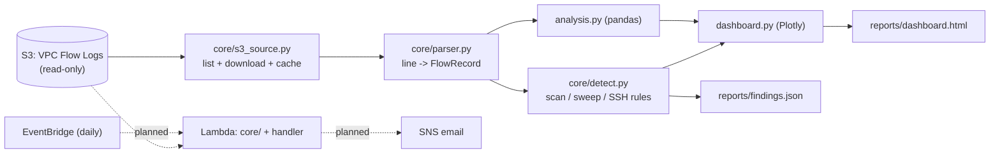

# VPC Flow Log Analyzer with Port-Scan Detection: Full Documentation

Written in simple words. Read top to bottom, or jump to the part you need.

## Contents

1. [Summary](#1-summary)
2. [The problem it solves](#2-the-problem-it-solves)
3. [Tech stack](#3-tech-stack)
4. [Key concepts in plain words](#4-key-concepts-in-plain-words)
5. [Architecture](#5-architecture)
6. [Folder layout](#6-folder-layout)
7. [How it was built, step by step](#7-how-it-was-built-step-by-step)
8. [Detection rules and false positives](#8-detection-rules-and-false-positives)
9. [Testing](#9-testing)
10. [Results on real logs](#10-results-on-real-logs)
11. [What broke and how it was fixed](#11-what-broke-and-how-it-was-fixed)
12. [How to run it](#12-how-to-run-it)
13. [Cost](#13-cost)
14. [What is finished and what is not](#14-what-is-finished-and-what-is-not)
15. [How this maps to real tools](#15-how-this-maps-to-real-tools)
16. [Interview questions and answers](#16-interview-questions-and-answers)
17. [Glossary](#17-glossary)

---

## 1. Summary

AWS can record every network connection in a network (a **VPC Flow Log**) and save it to S3. These logs are huge piles of text lines. This project is a **Python tool that reads those logs and turns them into answers**:

- Who talks the most?
- Which ports are blocked the most?
- When did blocked connections spike?
- **Is anyone scanning us?** (port scans, port sweeps, SSH brute force)

It is a command line tool plus a single-file HTML dashboard. The scan detection is written in plain Python, so it can later run unchanged inside **AWS Lambda** to email an alert when a scan is found.

## 2. The problem it solves

A flow log file only says "address A talked to address B on port X, allowed or blocked". Nobody can read thousands of such lines by hand. A security analyst needs to quickly see:
- which outside addresses keep knocking on our doors,
- whether someone is trying many ports (a scan),
- whether something inside our network is being blocked unexpectedly.

Paid tools do this (GuardDuty, a SIEM). This project builds the idea from scratch so every step is visible and costs almost nothing.

## 3. Tech stack

| Tool | Used for |
|---|---|
| **Python 3.14** | The whole tool |
| **boto3** | Talks to S3 (list and read only) |
| **pandas** | Answers questions about the data (group, count, sum) |
| **Plotly** | Charts inside the HTML dashboard |
| **pytest + moto** | Tests, with a fake S3 so tests never touch real AWS |
| **ruff** | Code style and error checks |
| **AWS S3** | Where the flow logs live (read-only) |
| **Git / GitHub** | Version control |
| *Planned:* **Terraform, Lambda, SNS, EventBridge** | Daily detection and email alerts |

## 4. Key concepts in plain words

- **Flow log record:** one line = one summary of traffic between two addresses in a short time window.
- **ACCEPT / REJECT:** allowed or blocked by a security group or network ACL.
- **Port:** a numbered door on a computer. 22 = SSH, 443 = HTTPS, 3306 = MySQL.
- **Port scan:** someone knocking on many doors of one machine to find open ones.
- **Port sweep:** someone knocking on the same door of many machines.
- **SSH brute force:** someone trying SSH (port 22) again and again, hoping to guess a password.
- **DataFrame (pandas):** a spreadsheet in Python. "Group by" is like a pivot table.
- **Sliding window:** look at all events in the last N seconds, move forward in time, repeat.
- **False positive:** the tool shouts "attack!" about something harmless. Tuning thresholds and allowlists reduces them.
- **Fixture:** a small hand-written sample file used by tests, so tests never depend on real data.
- **moto:** a library that pretends to be AWS, so tests can run without AWS.
- **Lambda:** AWS runs your small function when something triggers it, and charges only while it runs.

## 5. Architecture



**Why `core/` has no pandas:** pandas is over 100 MB and Lambda has a size limit. Parsing and detection are plain Python, so the same code serves the command line and the future Lambda.

## 6. Folder layout

```
flowlog_analyzer/
  __main__.py        command line: fetch, summary, detect, dashboard
  core/              plain Python (no pandas), shared with Lambda later
    parser.py          one line -> typed FlowRecord; is_private(); protocol names
    s3_source.py       list by day, download to cache, stream records (read-only)
    detect.py          scan / sweep / SSH brute-force rules
  analysis.py        pandas: top talkers, ports, rejects over time, internal vs external
  dashboard.py       Plotly -> one HTML file
tools/
  portscan.py        private-IP-only TCP scanner for testing my own servers
  validate.py        compares what the scanner did with what the detector found
tests/               62 tests + small hand-written fixtures
data/  reports/      gitignored (real logs and reports never go into git)
documentation/       this file
```

## 7. How it was built, step by step

**Phase 0: Preflight.** Confirmed I was the IAM user; found the log bucket and its region (`ap-southeast-2`); counted the log files (32 plus an empty folder marker); downloaded one file and read it; confirmed the default 14-field format; noted the 30-day expiry; confirmed no servers were running.

**Phase 1: Setup.** Git repo, `.gitignore` (so real data never gets committed), a Python virtual environment, `requirements.txt`, ruff and pytest config. System Python was 3.15, but pandas had no easy install there, so the project uses Python 3.14.

**Phase 2: Parser.** `parse_line` turns one line into a typed `FlowRecord`. It skips the header, turns `-` into "no value", keeps NODATA/SKIPDATA records apart, and returns nothing for broken lines instead of crashing. Hand-written fixture files hold about 30 fake lines covering every case. Checked against the real file: 34 records, same as `awk`.

**Phase 3: S3 loader.** AWS stores logs by day (`AWSLogs/<account>/vpcflowlogs/<region>/YYYY/MM/DD/`), so the loader asks only for the days wanted. It downloads to a local cache (a file already cached is not downloaded again) and only ever uses list and read calls. Tests use moto. On real data: 32 files, 2,367 records. An independent manual count of all cached files gave exactly 2,367.

**Phase 4: Analysis.** pandas turns records into a table, then answers: top talkers by bytes, top ports, top rejected ports, rejects per 5-minute bucket, accept vs reject per interface, internal vs external sources. Tests use fixtures with known answers (for example "port 3306 has exactly 4 rejects").

**Phase 5: Detection.** Three rules with a sliding time window (section 8), an allowlist, and severity levels. Tests found a real bug (section 11).

**Phase 6: Dashboard.** One self-contained HTML file with KPI cards, a findings table (severity colored, text safely escaped), a rejects-over-time chart, top talkers, top rejected ports, and internal vs external tables.

**Phase 7 (tools only): Scanner and validator.** `portscan.py` refuses any target outside `10.0.0.0/8`, scans one target and at most 1024 ports with few threads, and writes a "ground truth" file. `validate.py` checks the detection against it. Both are tested; **the live run is not done yet**.

## 8. Detection rules and false positives

| Rule | Fires when | Default |
|---|---|---|
| Vertical port scan | one source hits many different ports on one target, mostly REJECT | 15 ports in 5 min, 50%+ rejected |
| Horizontal sweep | one source hits the same port on many hosts, mostly REJECT | 5 hosts in 5 min, 50%+ rejected |
| SSH brute force | one outside source makes many connections to port 22 | 20 connections in 10 min |

**Severity.** Scan that finds open ports, or 100+ ports: high. Accepted SSH connections: high. A sweep from one of our own hosts toward the internet: low.

**How a window works.** Records are sorted by time. For each new record, the window drops anything older than N seconds. If the window now holds enough different ports (or hosts) and enough rejects, those records are flagged. Neighbouring flagged records form one finding, but a long quiet gap starts a new one.

**Why "mostly rejected" matters.** Replies to a big download come back to many different random ports of the downloader. By ports alone that looks like a scan. But those replies are ACCEPTed. A scanner mostly hits closed ports, which are REJECTed.

| Looks like a scan | Really is | How it is handled |
|---|---|---|
| Ubuntu servers sending data back to many ports | Package downloads | They are accepted, so the reject rule ignores them |
| Many hosts on port 443 | Normal browsing | Accepted |
| Many SSH connections from my own Mac | My tests | `--allow <ip>` |
| Our server blocked from going out to many hosts | A security group blocking updates | Marked low: "blocked egress, not a scan" |

## 9. Testing

62 tests, all passing, using only small fake data:

| File | Tests | What it proves |
|---|---|---|
| `test_parser.py` | 9 | field types, header skipped, `-` handling, NODATA, gzip equals plain, bad lines safe, private-IP check |
| `test_s3_source.py` | 7 | right day prefixes, other regions ignored, cache works (even after the object is deleted), time filter, plain `.log` also readable |
| `test_analysis.py` | 10 | known answers for every table, empty input does not crash |
| `test_detect.py` | 25 | 20 ports detected; 14 not, 15 yes; 300 s inside, 301 s outside; mostly-accepted ignored; two attackers separate; two bursts separate; allowlist; unsorted input; sweep and SSH boundaries; low severity for blocked egress |
| `test_dashboard.py` | 4 | all sections present, file over 10 KB, HTML in text is escaped, empty data safe |
| `test_tools.py` | 7 | scanner refuses public IPs and bad ranges, validator PASS and FAIL cases |

Also: each real-data result was cross-checked by hand (the total record count and the per-file counts matched `awk`).

## 10. Results on real logs

Data: the Project 1 and Project 2 lab networks, 32 files, 2,367 records from 7 network interfaces.

- 710 rejects (30%); 450 unique sources, 443 of them outside our private ranges.
- **Most rejected ports:** UDP 123 (the servers tried public time servers), TCP 443 (Project 1's bastion blocked by its own security group), **TCP 23 Telnet from 19 different internet addresses**, ICMP, SSH, **RDP 3389 from 8 addresses**, MySQL 3306. That is normal internet background scanning against two public IPs.
- **Biggest flows:** 31 MB package downloads to the Project 2 firewalls.
- **Detector output:** with my own IPs allowlisted, 2 low-severity findings (Project 1's bastion being blocked from going out). Without the allowlist, my own test SSH sessions were reported as SSH brute force, which shows the rule works and why the allowlist is needed.

No real attack was found, and no real scan has been run yet to prove detection end to end.

## 11. What broke and how it was fixed

| # | Problem | Cause | Fix |
|---|---|---|---|
| 1 | pandas would not install easily | System Python was 3.15 | Used Python 3.14 in the virtual environment |
| 2 | 33 objects listed but 32 files read | The 33rd is the empty folder marker `AWSLogs/<account>/` | Understood, not a bug |
| 3 | One file parsed to 0 records, manual count said 4 | It held only NODATA lines (an idle interface); parser drops them by default | Checked: totals across all files match exactly |
| 4 | Test expectations wrong (27 vs 25 records) | I miscounted the fixture by hand | Recounted with `awk`, fixed the test |
| 5 | Scan bursts hours apart came out as one finding | Flagged neighbours were joined without checking the time gap | Added a gap check and a test |
| 6 | Many "ports" from Ubuntu servers could look like scans | Download replies go to random ports | "Mostly rejected" rule, with a test |
| 7 | My own Mac reported as SSH brute force | My tests made many SSH connections | `--allow` option |
| 8 | Project 1's bastion reported as a "sweep" | Its own security group blocked its outbound updates | Low severity + explanation |
| 9 | Summary printed hundreds of empty time buckets | A long idle night in the data | Show only buckets with rejects |

**Lessons**
- Cross-check tool output against an independent count before trusting it.
- Tests find real bugs (number 5).
- The data teaches you what the rules must ignore (numbers 6 to 8).

## 12. How to run it

```bash
python3.14 -m venv .venv && source .venv/bin/activate
pip install -r requirements.txt
python -m flowlog_analyzer fetch     --days 30
python -m flowlog_analyzer summary   --days 30
python -m flowlog_analyzer detect    --days 30 --allow <my-ip>
python -m flowlog_analyzer dashboard --days 30 --allow <my-ip>    # reports/dashboard.html
pytest -q && ruff check .
```

Needs AWS credentials that can read the bucket. The tool never writes to S3.

## 13. Cost

$0 so far. S3 reads of a few kilobytes and a few cents at most. Nothing in AWS is running because of this project. The planned Lambda, SNS and EventBridge fit in AWS's free allowances; bringing up the Project 1 network for the live scan test costs about $0.05 per hour while it is up.

## 14. What is finished and what is not

**Finished and tested:** parser, S3 loader, pandas analysis, three detection rules, HTML dashboard, private-only scanner, validator.

**Not done yet:**
1. Live proof: bring up the Project 1 network, scan dev-app from the bastion with `tools/portscan.py`, wait about 10 minutes for flow logs, then run `tools/validate.py`.
2. Lambda function with SNS email alerts and a daily EventBridge schedule (Terraform, least-privilege IAM).
3. End-to-end test and screenshots.

## 15. How this maps to real tools

| This project | Real world |
|---|---|
| Read flow logs from S3 | Athena on flow logs, Amazon Security Lake |
| Scan / sweep / brute-force rules | Amazon GuardDuty (port probe and SSH brute-force findings) |
| Dashboard and findings table | Splunk, QRadar, Microsoft Sentinel, FortiAnalyzer |
| Allowlist and severity | SIEM tuning and alert triage |

## 16. Interview questions and answers

**Q1. Describe the project in one minute.**
I wrote a Python tool that reads VPC Flow Logs from S3, parses them into typed records, answers questions with pandas (top talkers, blocked ports, reject spikes), detects port scans, sweeps and SSH brute force with a sliding window, and builds a single-file HTML dashboard. 62 tests pass. I checked every number against an independent count. The detection code has no pandas so it can run in Lambda later.

**Q2. What is a flow log record? Walk me through one REJECT line.**
Fourteen fields: version, account, interface, source, destination, source port, destination port, protocol, packets, bytes, start, end, action, status. A line like `... 203.0.113.50 10.0.0.10 42983 989 6 1 52 ... REJECT OK` means a stranger sent one TCP packet to port 989 and a security group or NACL blocked it.

**Q3. How do you detect a port scan?**
Sort records by time and slide a window (5 minutes). If one source touches at least 15 different ports on one target in that window and most of the records are REJECT, flag it. Neighbouring flagged windows become one finding with source, target, ports, times and severity.

**Q4. Why require "mostly REJECT"?**
Replies to a big download return to many random ports and look like a scan by port count, but they are ACCEPTed. Scanners mostly hit closed ports.

**Q5. What false positives did you meet in real data?**
My own SSH test sessions (fixed with an allowlist), Ubuntu package downloads (ignored by the reject rule), and Project 1's bastion being blocked from going out (reported as low severity with an explanation).

**Q6. How did you check the tool was correct?**
Hand-written fixtures with known answers, and independent counts: `awk` counted 2,367 real records and the parser produced exactly 2,367. A one-file mismatch (0 vs 4) turned out to be NODATA lines.

**Q7. Why is the detection code free of pandas?**
pandas and numpy are over 100 MB and Lambda has package size limits. Keeping parsing and detection in plain Python keeps the Lambda zip tiny and lets the command line and Lambda share the same tested detector.

**Q8. What can flow logs not tell you?**
No payloads, nothing inside an encrypted tunnel, and not what a host's own firewall decided. A packet dropped by nftables on an instance still shows as ACCEPT because it reached the instance.

**Q9. How is the tool safe to run?**
S3 access is read-only. The scanner refuses anything outside `10.0.0.0/8`, scans one target and at most 1024 ports. Real data and reports are gitignored and tests use only fake data.

**Q10. What would you add next?**
The live proof with my own scanner, a daily Lambda with SNS email alerts and least-privilege IAM, and GuardDuty or Athena for comparison.

**Q11. How would you detect a slow scan spread over hours?**
Use a longer window or a per-source counter over a day, with a lower rate threshold. The trade-off is more false positives, so I would need stronger allowlists and baselining.

**Q12. How would you make this scale to a very large bucket?**
Query with Athena (partition projection) instead of downloading, or run the Lambda per day-prefix and keep a small state of already-processed files.

## 17. Glossary

| Term | Meaning |
|---|---|
| ACCEPT / REJECT | Flow log result: allowed or blocked |
| Allowlist | Sources the detector ignores on purpose |
| DataFrame | pandas table |
| ENI | A server's virtual network card |
| False positive | An alert about harmless activity |
| Fixture | A small fake sample file used by tests |
| Flow log | AWS record of network connections |
| moto | Library that fakes AWS for tests |
| NODATA | Flow log line meaning "no traffic in this window" |
| Port scan | Trying many ports on one machine |
| Port sweep | Trying one port on many machines |
| SIEM | Security tool that collects and alerts on logs |
| Sliding window | Looking at events in the last N seconds as time moves |
